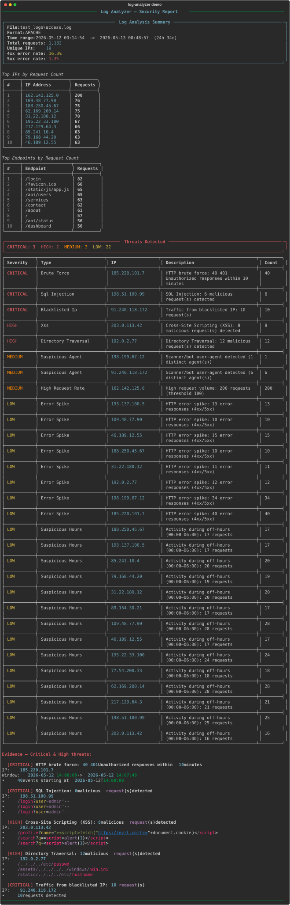

# Log Analyzer


A CLI cybersecurity log analysis tool that detects threats in Apache, Nginx, SSH,
syslog, and Windows Event logs.



## Install

```bash
pip install -r requirements.txt
```

## Quick Start

```bash
# Analyze an Apache/Nginx access log (format auto-detected)
python log_analyzer.py --file access.log

# SSH auth.log with explicit format
python log_analyzer.py --file /var/log/auth.log --format ssh

# Export to JSON + HTML (files saved alongside the log)
python log_analyzer.py --file access.log --export json --export html

# Export CSV of suspicious IPs only
python log_analyzer.py --file access.log --export csv

# Skip geolocation (faster, no internet needed)
python log_analyzer.py --file access.log --no-geo

# Watch mode — tail the file in real time
python log_analyzer.py --file access.log --watch

# Compare two log files and show what changed
python log_analyzer.py --file access_today.log --diff access_yesterday.log

# Custom thresholds and time window
python log_analyzer.py --file access.log \
  --threshold 50 \
  --brute-threshold 3 \
  --brute-window 5 \
  --suspicious-hours 22-6

# Apply IP whitelist and blacklist
python log_analyzer.py --file access.log \
  --whitelist config/whitelist.txt \
  --blacklist config/blacklist.txt

# Export all formats to a custom output path
python log_analyzer.py --file access.log \
  --output /reports/june-15 \
  --export json --export csv --export html
```

## Supported Log Formats

| Format | Example file | Detection |
|--------|-------------|-----------|
| Apache / Nginx Combined | `access.log` | Auto |
| SSH auth.log | `/var/log/auth.log` | Auto |
| Syslog (RFC 3164 & 5424) | `/var/log/syslog` | Auto |
| Windows Event Log (text export) | `security.log` | Auto |
| Compressed files | `access.log.gz` | Transparent |

Use `--format auto` (default) or specify explicitly:
`apache`, `nginx`, `ssh`, `syslog`, `windows`.

## Threat Detection

| Threat | Severity | Trigger |
|--------|----------|---------|
| SSH brute force | HIGH / CRITICAL | >5 failed logins per IP in 10 min |
| HTTP brute force | HIGH / CRITICAL | >5 × 401 responses per IP in 10 min |
| Endpoint scan | MEDIUM / HIGH | >20 unique paths per IP in 5 min |
| SQL Injection | CRITICAL | 20+ known SQLi patterns in URL/params |
| XSS | HIGH | 13+ known XSS patterns |
| Directory traversal | HIGH | `../`, `/etc/passwd`, `.ssh/id_rsa`, `system32`, `win.ini`, etc. |
| Attack-tool user-agents | MEDIUM | nikto, sqlmap, nmap, masscan, gobuster, … |
| Scripted HTTP clients | LOW | curl, python-requests, Go-http-client, empty user-agent |
| High request rate | MEDIUM / HIGH | Configurable (default 100 req per IP) |
| HTTP error spike | LOW / MEDIUM | ≥10 4xx/5xx responses from same IP |
| Off-hours activity | LOW | Configurable hour range (default 00–06) |
| Blacklisted IPs | CRITICAL | Any IP or CIDR range listed in `--blacklist` file |

Brute-force and scan detection use a sliding window with two pointers, so they run in linear
time: 100,000 failed logins from one IP are checked in a few milliseconds.

Payload rules are tuned to avoid common false positives: an encoded apostrophe (`O%27Brien`),
a parameter such as `page1=1` or a hex string in a path are not reported as SQL injection.

## CLI Reference

```
Options:
  -f, --file TEXT                Log file to analyze  [required]
  -F, --format [auto|apache|nginx|ssh|syslog|windows]
                                 Force log format  [default: auto]
  -o, --output TEXT              Base path for exported files
  -e, --export [json|csv|html]   Export format (repeatable)
  -t, --threshold INTEGER        Request-rate alert threshold  [default: 100]
      --brute-threshold INTEGER  Failed login threshold  [default: 5]
      --brute-window INTEGER     Brute-force window (minutes)  [default: 10]
      --scan-threshold INTEGER   Unique endpoint scan threshold  [default: 20]
      --suspicious-hours TEXT    Off-hours range HH-HH  [default: 0-6]
      --top-n INTEGER            Top IPs / endpoints to display  [default: 10]
      --whitelist FILE           File of whitelisted IPs / CIDR ranges
      --blacklist FILE           File of blacklisted IPs / CIDR ranges
      --diff FILE                Second log to compare against
      --no-geo                   Skip geolocation (faster)
  -w, --watch                    Real-time tail / watch mode
      --fail-on [none|low|medium|high|critical]
                                 Exit with code 2 if a threat of this severity
                                 or higher is found  [default: none]
  -h, --help                     Show this message and exit
```

### Exit codes and automation

| Code | Meaning |
|------|---------|
| 0 | Analysis finished (no threat at or above `--fail-on`) |
| 1 | Error (file not found, nothing could be parsed, …) |
| 2 | Threats found at or above the `--fail-on` severity |

This makes the tool easy to use in scripts, cron jobs or CI pipelines:

```bash
python log_analyzer.py --file /var/log/nginx/access.log --no-geo --fail-on high \
  || echo "High-severity activity found, check the report"
```

## Exported Files

| Format | Content |
|--------|---------|
| `*_report.json` | Full report: stats, threats, geo data |
| `*_suspicious_ips.csv` | Per-IP table: requests, threats, geo, severity |
| `*_report.html` | Standalone dark-theme HTML dashboard |

## Project Structure

```
log_analyzer.py          # CLI entry point
modules/
  parser.py              # Log format detection & parsing
  detector.py            # Threat detection engine
  reporter.py            # Terminal / JSON / CSV / HTML output
  geoip.py               # IP geolocation (ip-api.com)
  watcher.py             # Real-time file monitoring
config/
  whitelist.txt          # IPs / CIDR ranges to exclude from analysis
  blacklist.txt          # IPs / CIDR ranges to flag as CRITICAL
tests/                   # pytest suite (parser, detector, reporter, watch mode, CLI)
docs/demo.svg            # Screenshot used in this README
generate_test_logs.py    # Builds realistic sample logs with injected attacks
make_screenshot.py       # Regenerates docs/demo.svg
requirements.txt
requirements-dev.txt     # + pytest
```

## IP Whitelist / Blacklist

Plain text files, one IP or CIDR range per line (IPv4 and IPv6). Lines starting with `#`
are comments.

```
# config/whitelist.txt
10.0.0.1
192.168.0.0/16
```

```
# config/blacklist.txt
198.51.100.99
185.220.101.0/24
```

## Geolocation

Uses the free [ip-api.com](http://ip-api.com) batch API (no API key required).
Only public IP addresses are looked up: private ranges, loopback, link-local and values that
are not valid IPs are never sent. The free tier only supports plain HTTP, so use `--no-geo`
for sensitive logs or offline analysis.

## Watch Mode

Monitors the file for new lines and prints real-time threat alerts. New lines go into a sliding
window that covers the longest detection window, so attacks that build up over minutes (brute
force, scans) are still caught when lines arrive one at a time. Each threat is alerted once per
IP, and again only if its severity rises.

```
python log_analyzer.py --file access.log --watch
```

Output format:
```
10:23:45  [HIGH]  Brute Force  10.0.0.1  — HTTP brute force: 7 401 responses within 10 minutes
```

## Safe handling of hostile log data

Every field in a log can be controlled by an attacker, so the tool treats it as untrusted:

- **Terminal:** log text is escaped before printing, so a request such as `/?q=[/x]` cannot
  break or fake the report.
- **HTML report:** all values are HTML-escaped.
- **CSV export:** cells that start with `=`, `+`, `-` or `@` are prefixed with `'`, so they
  are not run as formulas when the file is opened in Excel or LibreOffice.

## Running the tests

```bash
pip install -r requirements-dev.txt
pytest                                   # fast suite
pytest tests/test_performance.py --run-slow   # 100k-line performance tests
```

## Requirements

- Python 3.10+
- Windows 10 / Linux / macOS
